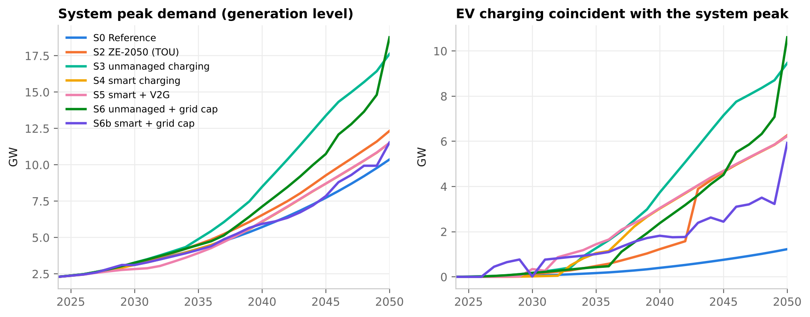

# KEZERT — Kenya Zero-Emission Road Transport model

[](https://github.com/DrOgeed/kenya-zero-emission-road-transport/actions/workflows/ci.yml)


An open, fully documented **OSeMOSYS** energy-system model of Kenya. It tests whether **every road vehicle can be zero-emission by 2050 without crippling the power sector and national grid**, and what that depends on. The model is built for **MUIO v5.7**, the UN DESA modelling interface, and ships as a ready-to-load MUIO case. It is also scripted end-to-end in Python, so every number is reproducible and traceable to a cited source.

* **Power sector.** The published CCG OSeMOSYS Kenya Power System Model v3.0.0, ingested programmatically and adapted to MUIO v5.7. It covers plant- and resource-zone detail, 48 timeslices, storage and imports.
* **Road transport.** A new stock-based module: 9 vehicle classes, 24 technologies, and the current stock from motorcycles to heavy trucks. It is calibrated to KNBS 2024 fuel use.
* **The grid question made measurable.**
  * Four charging technologies (home, depot, battery swap, fast/corridor), each with its own capacity cost.
  * Three charging regimes: unmanaged, time-of-use, smart.
  * Vehicle-to-grid.
  * A reserve-margin constraint that sees EV load at the peak.
  * Annual reporting of peak demand, firm capacity, firm shortfall and unserved energy.
* **25 scenarios.** Phased ICE bans; charging regimes; build-constrained vs accelerated grids; Avoid–Shift–Improve; three heavy-freight routes; market instruments without bans; nine sensitivities.

## Headline results (2024–2050)

| | Reference S0 | ZE bans S2 (TOU) | Unmanaged S3 | Smart S4 | Grid-capped + unmanaged S6 |
|---|---|---|---|---|---|
| Road CO2 in 2050 (Mt) | 11.9 | 0 | 0 | 0 | 0 |
| Cumulative road CO2 2024–50 (Mt) | 338 | 189 | 208 | 181 | 262 |
| EV charging 2050 (TWh) | 13.6 | 31.5 | 27.7 (+9.4 TWh H2) | 31.5 | 25.0 (+16.2 TWh H2) |
| System peak 2050 (GW) | 10.4 | 12.3 | **17.6** | **11.5** | 18.8 |
| Unserved energy 2024–50 (TWh) | 0 | 0 | 0 | 0 | **42** |
| Total system cost 2024–60 (bn US$, disc. 10 %) | 158.6 | 151.5 | 157.4 | 150.2 | 272.4 |
| Road fuel imports 2024–50 (bn US$) | 120 | 66 | 73 | 63 | 92 |

1. **Zero-emission road transport by 2050 is feasible and cheaper over the system's life than the reference** (−4.5 %). It cuts cumulative road CO2 by 44 % and halves fuel imports. The saving depends on removing the finance and supply barriers that the reference diffusion limits represent.
2. **Charging behaviour decides the grid outcome.** Unmanaged charging raises the 2050 peak to 17.6 GW. Smart charging holds it at 11.5 GW, saving about US$7 bn, including about US$17 bn less transmission and distribution investment.
3. **The real threat is build rate.** At historical build rates (S6) the reserve margin collapses below 1.0 around 2040 and 42 TWh goes unserved. Smart charging delays this by about a decade but cannot prevent it. The smart pathway needs about 0.9 GW of new capacity every year, 4–5× the historical pace.
4. **Smart charging moves the peak to the night.** From the 2040s, night electricity costs more than evening electricity. Today's off-peak e-mobility tariff will need to become dynamic.
5. **Without bans** (carbon price + green finance, S10), the fleet reaches 84 % zero-emission vehicles but not zero. **Avoid–Shift–Improve** (S8) is the cheapest zero-emission pathway. **Battery-electric trucks** beat hydrogen and renewable diesel at the assumed costs, but the heavy-freight evidence base is thin.
6. **Fuel-tax revenue of about US$2.3 bn a year disappears by 2050.** Road funding needs a replacement instrument.

See [docs/06_results.md](docs/06_results.md) for the full results, figures and robustness checks, and [docs/04_limitations_and_data_gaps.md](docs/04_limitations_and_data_gaps.md) before citing any number.



## Quick start

### Option A: MUIO (no coding)

1. Install [MUIO v5.7](https://github.com/OSeMOSYS/MUIO).
2. **Upload case** → `muio/KEZERT_MUIO_v5.7_case.zip`. The case is about 170 MB unpacked.
3. Pick a case run, e.g. `S4_ZE_SMART`, and press **Run**.

[docs/03_muio_guide.md](docs/03_muio_guide.md) explains the case layout, scenario layers and the parity check.

### Option B: Python pipeline (reproduces everything)

```bash
sudo apt install glpk-utils          # glpsol builds the LP from the MUIO model file
pip install -r requirements.txt
python scripts/run_scenarios.py --jobs 2   # ~1 h for all 25 scenarios on 2 cores
python scripts/make_figures.py && python scripts/make_docs.py
python scripts/export_muio.py              # rebuild the MUIO case
pytest -q                                  # fast tests (add MUIO_SRC=... for the GUI-parity test)
```

## Verification

* **GUI parity.** MUIO's own data-file generator (`generateDatafile` + `preprocessData`, imported from the MUIO v5.7 source) is run on the exported case. The result is solved with the unmodified MUIO model file and compared with the Python pipeline. They agree to 1–2 × 10⁻⁸ in objective, with identical matrix size, for S4 and S6 over the full 2024–2060 horizon. See [`muio/muio_verification.json`](muio/muio_verification.json). CI repeats this on a short horizon for every commit.
* **Calibration.** 2024 bottom-up road fuel equals KNBS road petrol and diesel. Modelled 2024 peak (2.30 GW), generation (15.5 TWh) and firm capacity (2.49 GW) match EPRA and KPLC figures (2.32 GW, 14.5 TWh, ~2.50 GW).
* **Provenance.** Every input value carries a `source_id` and an A/B/C confidence rating ([docs/generated/assumption_tables.md](docs/generated/assumption_tables.md)). The conflicts between sources and the choices made are logged in [docs/04](docs/04_limitations_and_data_gaps.md).

## Repository map

```
model/osemosys_muio_v5.7.txt        unmodified MUIO v5.7 OSeMOSYS model file
data/external/ccg_kenya_psm_v3/     CCG Kenya Power System Model v3 data (CC BY 4.0)
data/assumptions/*.csv              transport, charging, fuel, demand, policy inputs + sources.csv
src/kezer/                          build.py (model), scenarios.py, solve.py, results.py, muio_case.py, gmpl_io.py
scripts/                            run_scenarios, postprocess, make_figures, make_docs, export_muio
results/scenarios/<ID>/*.csv        indicator tables per scenario
results/figures/                    report figures
results/headline_indicators.csv     cross-scenario summary
muio/                               MUIO case (zip) + parity verification
docs/                               methodology, scenarios, MUIO guide, limitations, reproducibility, results
docs/generated/                     auto-generated tables (inputs, sets, scenario matrix, results)
tests/                              regression + calibration + MUIO-parity tests
```

## Documentation

1. [Methodology](docs/01_methodology.md): framework, reference energy system, power and transport modules, calibration, indicators.
2. [Scenario design](docs/02_scenarios.md) and the [full scenario matrix](docs/generated/scenario_matrix.md).
3. [Using the model in MUIO](docs/03_muio_guide.md).
4. [Limitations, data gaps and conflicts log](docs/04_limitations_and_data_gaps.md).
5. [Reproducibility](docs/05_reproducibility.md).
6. [Results](docs/06_results.md).
* Inputs: [assumption tables](docs/generated/assumption_tables.md), [technologies, commodities, constraints](docs/generated/technology_list.md).

## How to cite

See [`CITATION.cff`](CITATION.cff). Please also cite the power-sector model this work builds on:

> Kihara M., Lubello P., Millot A. et al. (2024). *Mid- to long-term capacity planning for a reliable power system in Kenya.* Energy Strategy Reviews 52, 101312. https://doi.org/10.1016/j.esr.2024.101312. The data are from the OSeMOSYS Kenya PSM v3.0.0 (Climate Compatible Growth), CC BY 4.0.

## Licences

* Code (`src/`, `scripts/`, `tests/`): Apache-2.0.
* Data, results and documentation: CC BY 4.0.
* Third-party components keep their licences; see [LICENSE-DATA.md](LICENSE-DATA.md).

## Acknowledgements

Power-sector data and structure: Climate Compatible Growth (CCG) OSeMOSYS Kenya Power System Model. Modelling interface: MUIO (OSeMOSYS community / UN DESA). Solvers: GLPK (matrix generation) and HiGHS.
