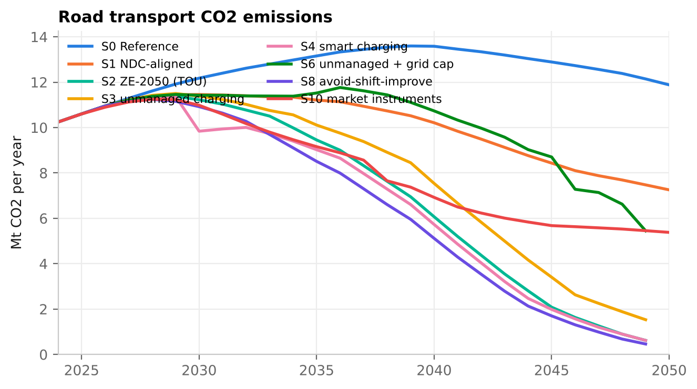
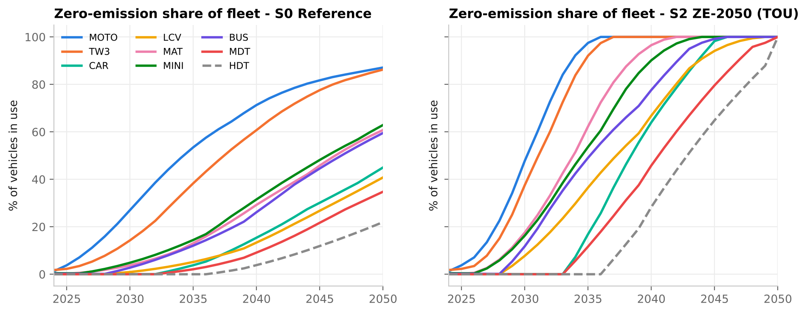
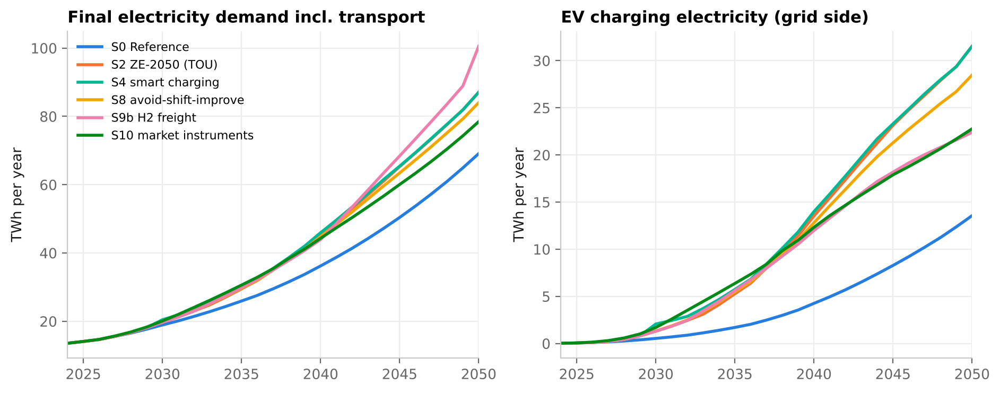
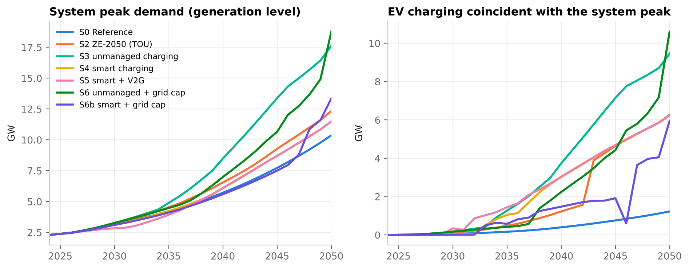
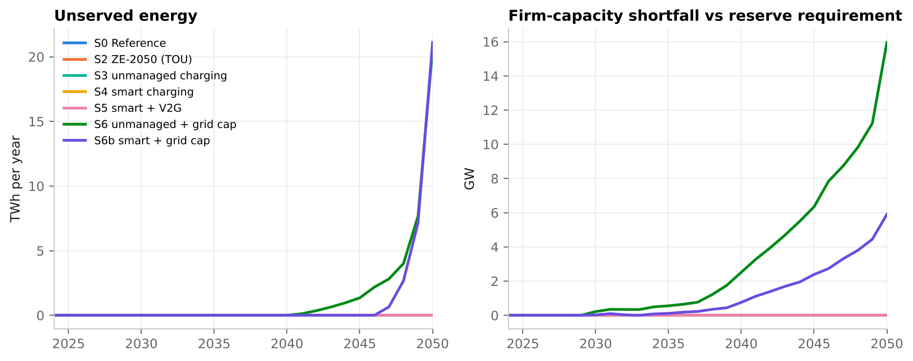
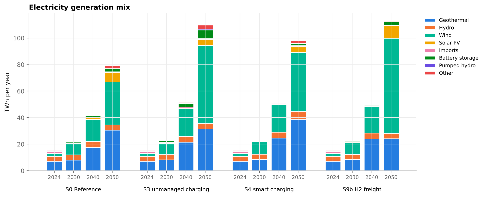
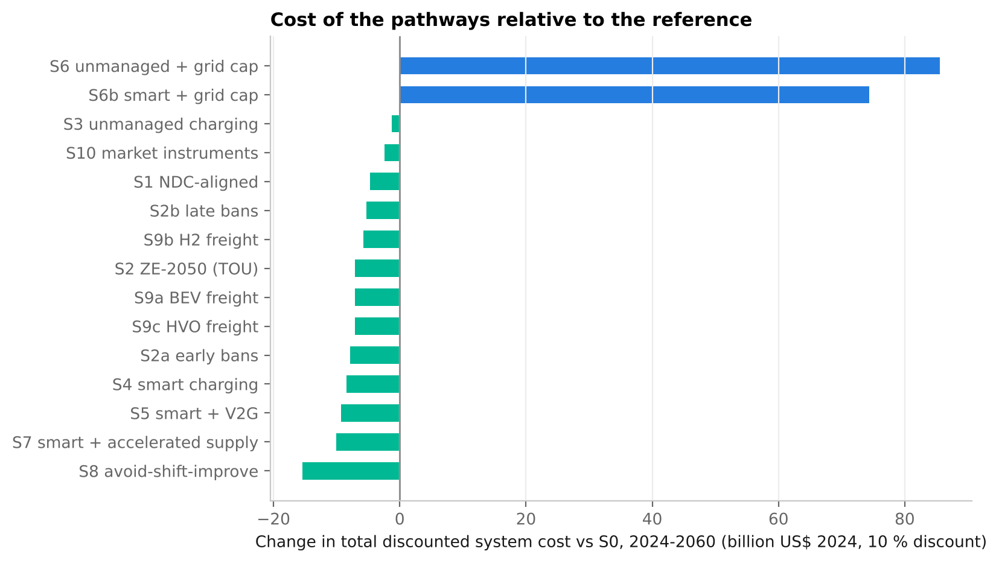
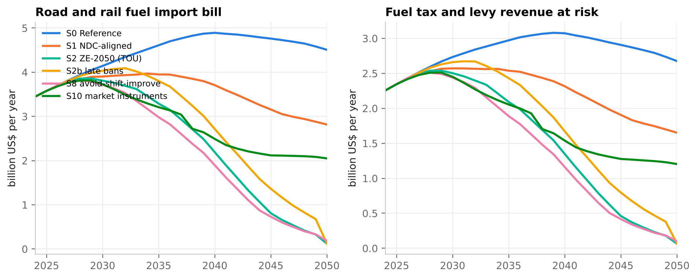

# 6. Results

All numbers come from `results/scenarios/<ID>/*.csv`. The cross-scenario table is `docs/generated/results_tables.md` (also `results/headline_indicators.csv`). Costs are in US$ 2024. "Total cost" means total discounted system cost for 2024–2060 at 10 %, covering vehicles, fuels, charging, generation, storage and grids. Fuel taxes are excluded from cost because they are transfers.

## 6.1 Base-year calibration (2024)

| Indicator | Model | Observed | Source |
|---|---|---|---|
| Road petrol + diesel | 62.5 + 79.8 PJ (calibrated) | KNBS road shares of 1,492.6 kt petrol and 2,208.4 kt diesel | KNBS Economic Survey 2025 |
| Road transport CO2 | 10.25 Mt | 12.09 MtCO2e (2019, road, all GHG); 10.8 Mt (2023, all transport) | GoK via GIZ; EDGAR |
| Electricity generation | 15.5 TWh | 14.5 TWh (FY2024/25) | EPRA |
| System peak | 2.30 GW | 2.32 GW (FY2024/25) | EPRA |
| Firm capacity | 2.49 GW | ~2.50 GW (Dec 2025) | KPLC via Business Daily |

## 6.2 Key findings

**1. Zero-emission road transport by 2050 is feasible and lowers total system cost.**

| | Reference (S0) | Phased bans (S2) |
|---|---|---|
| Total system cost | US$158.6 bn | US$151.5 bn (−4.5 %) |
| Cumulative road CO2, 2024–2050 | 338 Mt | 189 Mt (−44 %) |
| Road fuel import bill, 2024–2050 (undiscounted) | US$120 bn | US$66 bn |

The saving arises because battery-electric vehicles have lower lifetime cost than fossil ones in most classes from the 2030s. Under S0, adoption is held back by the diffusion limits, which represent finance, supply and charging-access barriers. **The saving is only real if policy also removes those barriers.** A ban on its own does not create finance for a boda rider.

**2. Electrification adds a large new load.** EV charging reaches 31.5 TWh in 2050, equal to 57 % of all other electricity demand (55.5 TWh). Total final electricity demand is about 26 % above the reference, where EVs already use 13.6 TWh. Generation is 98 TWh in S2/S4 vs 79 TWh in S0.

**3. Whether the grid copes depends on *when* vehicles charge, more than on how many there are.**

| 2050 | Unmanaged (S3) | TOU (S2) | Smart (S4) | Reference (S0) |
|---|---|---|---|---|
| System peak (GW) | 17.6 | 12.3 | 11.5 | 10.4 |
| EV load at peak (GW) | 9.5 | 6.3 | 6.2 | 1.2 |
| Stationary batteries (GW) | 16.1 | 8.3 | 7.2 | 8.6 |
| T&D investment 2025–50 (bn US$) | 42.1 | 27.5 | 25.2 | 22.1 |
| Total cost (bn US$) | 157.4 | 151.5 | 150.2 | 158.6 |

* **Value of smart charging.** Smart charging is worth about US$7.2 bn against unmanaged charging. It avoids about 6 GW of peak demand and 17 bn US$ of grid investment.
* **Unmanaged charging also changes the freight technology choice.** Heavy freight shifts partly to hydrogen (9.4 TWh of electrolysis in 2050), because annually balanced electrolysers can avoid the evening peak.

**4. Smart charging moves the peak to the night, which turns today's tariff logic around.**

* **Peak timing.** In S2 and S4 the system peak moves from late afternoon (15–21 h) to 21–24 h by 2040–2050, when managed fleets plug in.
* **Marginal cost inverts.** From the 2040s the marginal cost of electricity at night (≈13–14 US¢/kWh) exceeds the evening cost (≈5–6 US¢/kWh).
* **Implication for EPRA.** The KES 8 off-peak e-mobility rate is right for today's geothermal-surplus nights. It will need dynamic or rotating windows once EVs dominate night load, otherwise it will create a "timer peak".
* **Reserve reporting.** The 25 % reserve criterion is enforced at the evening peak slices. Night-time margins are reported ex post: 1.17 in S4 in 2050.

**5. "Crippling the grid" is a build-rate risk, not an EV risk.** S6 and S6B limit construction in every year from 2024 to historical rates (see docs/02):

| | S6 unmanaged | S6B smart |
|---|---|---|
| First year reserve margin < 1.0 | 2039 | 2043 |
| Reserve margin 2040 / 2045 / 2050 | 0.89 / 0.65 / 0.40 | 1.12 / 0.93 / 0.56 |
| First year with unserved energy | 2041 | 2047 |
| Unserved energy 2024–50 | 40.7 TWh | 31.6 TWh |
| Firm shortfall in 2050 | 16.0 GW | 5.9 GW |
| Unserved share of 2050 demand | ≈24 % | ≈24 % |
| Power-sector CO2 in 2050 | 9.4 Mt (15.2 TWh gas) | 9.4 Mt |
| Cumulative road CO2 2024–50 | 265 Mt | 246 Mt |

Smart charging delays the failure by four to six years. By 2050 both cases shed about a quarter of demand, because the bans have electrified the whole fleet whatever the charging regime. Shortages also slow pre-ban electrification, so cumulative road CO2 is 57–65 Mt higher than in S3/S4, and gas plants inside the "other firm" allowance add 9.4 Mt of power-sector CO2 in 2050. **Demand management buys time; it cannot replace building.** Total costs (S6 US$244.2 bn, S6B US$232.9 bn) include unserved energy at VOLL and the reserve-shortfall penalty, so they measure welfare loss, not spending.

The central smart pathway (S4) needs total capacity to grow from 3.2 GW (2024) to 25.8 GW (2050), about 0.9 GW a year, roughly 4–5 times Kenya's historical rate. By 2050 that is:

* geothermal 4.7 GW;
* wind 8.9 GW;
* solar 2.2 GW;
* batteries 7.2 GW.

**6. Ban timing.**

| Ban timing | Total cost (bn US$) | Cumulative road CO2 (Mt) | Idle fossil vehicles in 2050 |
|---|---|---|---|
| Early, 2027–35 (S2A) | 150.7 | 166 | — |
| Central (S2) | 151.5 | 189 | — |
| Late, 2035–45 (S2B) | 153.3 | 216 | 79,000 (stranded) |

Earlier bans are cheaper and cleaner. Late bans push stranded vehicles onto owners, many of them small operators. Under perfect foresight the optimiser delays car and truck electrification until shortly before each ban (see `results/figures/fig06_zev_fleet_share.png`). Real markets need a longer runway than that.

**7. Instruments without bans do not reach zero.** S10 combines a carbon price rising to US$150/t, green finance and faster diffusion. It reaches 84 % zero-emission vehicles in use and 5.4 Mt CO2 in 2050, with 223 Mt cumulative. NDC-aligned measures (S1) reach 7.3 Mt in 2050. Reaching zero needs registration bans or an equivalent mandate.

**8. Avoid–Shift–Improve is the cheapest pathway.** Moving car trips to buses/BRT and truck freight to rail, plus logistics efficiency (S8), costs US$143.1 bn. That is US$8.4 bn less than S2, and it lowers the 2050 EV load by 3 TWh.

**9. Heavy freight.**

* Battery-electric trucks are the least-cost zero-emission option at the assumed costs. When fuel-cell trucks are allowed (S2), the model does not choose them.
* Forcing hydrogen (S9B) adds US$1.4 bn and 22.6 TWh of electrolysis by 2050.
* Renewable diesel at US$36–45/GJ is not chosen (S9C).

Kenyan cost data for heavy freight barely exist, so treat these results as exploratory.

**10. Vehicle-to-grid** (S5) saves a further US$0.9 bn. Parked depot fleets provide 7.7 GW of discharge capacity and displace 5 GW of stationary batteries.

**11. Fiscal exposure.** Fuel taxes and levies of about US$2.3 bn a year in 2024 (≈KES 70–80/L) fall almost to zero by 2050 in every zero-emission scenario. In the reference they would be about US$2.7 bn a year. Cumulative 2024–2050 revenue is about US$42 bn under S2 against US$76 bn in the reference. Kenya needs a replacement road-funding instrument, for example distance- or weight-based charges or an e-mobility levy, phased in from the 2030s.

## 6.3 Robustness (paired sensitivities)

Each sensitivity was run on both S2 (`SEN_*`) and S0 (`REF_*`), so the saving from the zero-emission pathway is measured under identical assumptions. Zero road emissions in 2050 are reached in every case, and **the zero-emission pathway is cheaper than the reference under every sensitivity.**

| Sensitivity | Reference (bn US$) | ZE-2050 (bn US$) | Saving | ZE cum. road CO2 2024–50 (Mt) | Note |
|---|---|---|---|---|---|
| Central | 158.6 | 151.5 | 7.1 | 189 | |
| ZEV/battery cost −20 % | 155.0 | 142.1 | 12.9 | 158 | Faster uptake before the bans |
| ZEV/battery cost +25 % | 162.4 | 161.1 | 1.3 | 220 | Saving nearly vanishes |
| Demand growth +1 pp/yr | 184.2 | 175.9 | 8.3 | 206 | 2050 peak 16.0 GW (ZE) |
| Demand growth −1 pp/yr | 137.3 | 131.4 | 5.9 | 173 | 2050 peak 9.5 GW (ZE) |
| Multi-year drought | 158.8 | 151.8 | 7.0 | 189 | No unserved energy; geothermal-heavy mix is drought-robust |
| Oil price ×1.5 | 176.3 | 162.7 | 13.6 | 157 | Reference retires 548k fossil vehicles early |
| Oil price ×0.7 | 147.7 | 143.9 | 3.8 | 208 | |
| Discount rate 6 % | 281.1 | 266.1 | 15.0 | 186 | Totals not comparable across rates |
| Discount rate 14 % | 102.1 | 98.4 | 3.7 | 190 | |

The saving is most sensitive to vehicle and battery costs, oil prices and the discount rate.

## 6.4 Figures

| | |
|---|---|
|  |  |
|  |  |
|  |  |
|  |  |
